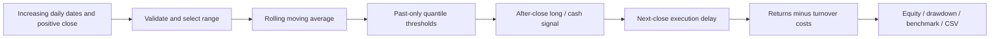
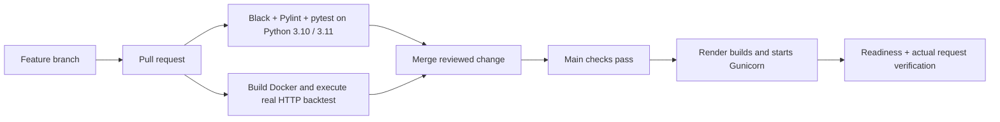

# Mean Reversion Backtester

A Flask application for exploring a **long-or-cash, rule-based mean reversion strategy**. Upload dated closing prices, compare net strategy returns with buy-and-hold, inspect drawdowns and download the calculation. There is no trained machine-learning model in this project.

The bundled demonstration is **synthetic**, generated from a fixed random seed. It is not HAPPSTMNDS or any other traded security, and its returns are not evidence of real investment performance. The original finance notebook remains in the repository for historical learning context.

## Problem and user journey

A price can move away from its recent average. A mean reversion rule asks whether buying after a relatively low deviation and returning to cash after a relatively high deviation would have worked historically. This is a research question, not an assumption that prices must return to an average.

1. Run the app and explore the clearly labelled synthetic example.
2. Download its `date,close` CSV format or upload your own lawful, verified daily-price data.
3. Set the moving-average window, historical calibration lookback, entry/exit quantiles and trading cost.
4. Optionally restrict the date range. The selected range must still contain enough calibration history.
5. Inspect the equity and drawdown plots, compare the cost-aware benchmark, and export the per-date curve.



## Strategy mathematics, without hidden look-ahead

For close price `P[t]` and window `w`, the moving average is `SMA[t] = mean(P[t-w+1:t])`. The deviation ratio is `R[t] = P[t]/SMA[t]`. A ratio below 1 means the current price is below its recent average; it does not necessarily mean the asset is cheap.

Entry/exit thresholds are quantiles of a **rolling historical window shifted by one observation**, so today's ratio is not used to set today's thresholds. Below the lower quantile the signal becomes long; above the upper quantile it becomes cash; between them it retains its previous state. Missing calibration observations do not produce a trade.

```mermaid
sequenceDiagram
 participant T as Close on day t
 participant N as Close on day t+1
 participant R as Return t+1 to t+2
 T->>N: Compute signal using data available after close t
 N->>R: Execute at next close; exposure begins afterwards
```

The array expression is `position = signal.shift(2)`: a signal observed **after close t** cannot earn the return ending at close t+1 if the trade executes at that next close. This extra delay deliberately avoids pretending that a closing price can both generate and execute a trade instantly.

A basis point is 0.01%. At 10 bps, a full entry costs 0.1% of equity. For exposure `p[t]`, market return `r[t]`, and one-way rate `c`:

```text
turnover[t] = abs(p[t] - p[t-1])
net_growth[t] = (1 + p[t] * r[t]) * (1 - turnover[t] * c)
equity[t] = equity[t-1] * net_growth[t]
```

Terminal liquidation also incurs a cost. Buy-and-hold is evaluated over the same post-calibration period with entry and exit costs. This is still a simplified close-price backtest: spread, intraday execution, financing, taxes, dividends, market impact and failed fills are not modeled separately.

## Metrics and what they miss

| Measure | Calculation / interpretation | Limitation |
|---|---|---|
| Total return | Ending equity minus starting equity, relative to starting equity | Depends strongly on chosen dates. |
| Annualized return | `(ending / starting)^(periods_per_year / n) - 1` | Short samples can exaggerate; frequency must match input. |
| Maximum drawdown | Largest fall from a running equity peak, including initial capital | Describes the observed path, not the worst future loss. |
| Sharpe, zero risk-free rate | Mean period return / sample standard deviation × square root of periods/year | Assumes a zero cash rate and can mislead with skew, dependence or short samples. |
| Equity curve | Compounded net growth from an initial value of 1 | Attractive curves can be overfit by parameter searching. |

The annualization default is 252 for daily trading observations. Change it for a different observed frequency; the app does not infer an exchange calendar. Zero volatility yields an undefined Sharpe instead of infinity. Cash earns zero. There is no independent out-of-sample claim: choosing parameters after viewing a chart can overfit this historical sample.

## Data contract

CSV or JSON records require `date` and `close`. Use ISO dates (`2024-01-02`), one unique date per observation, increasing order and positive finite prices. Between 50 and 5,000 rows are accepted, subject to the longer minimum needed for your chosen windows. Intraday timestamps and timezone-aware dates are rejected. The app never invents missing closes.

For actual equities, decide consistently whether prices are split/dividend adjusted. A split in unadjusted data can create false returns. Record vendor, download date, adjustment choice, currency and usage rights. The app does not download live prices or identify an instrument from an anonymous CSV.

## Run locally

Use Python 3.10 or 3.11:

```bash
git clone https://github.com/subhashdixit/mean-reversion-backtester.git
cd mean-reversion-backtester
python3 -m venv .venv
source .venv/bin/activate
python -m pip install -r requirements-dev.txt
python -m pip install --no-deps -e .
python -m flask --app wsgi:app run --port 8000
```

Open `http://127.0.0.1:8000`. For a production process on Linux:

```bash
gunicorn --config gunicorn.conf.py wsgi:app
```

Gunicorn manages WSGI requests outside Flask's development server. The app factory separates web wiring from the calculation module. Dataclasses express strategy configuration; functions handle validation, signals and reporting. Matplotlib renders server-side PNGs without a GUI, protected by a lock for concurrent requests.

```text
src/backtester/core.py       validated causal strategy and metrics
src/backtester/charts.py     equity and drawdown rendering
src/backtester/web.py        Flask factory, forms, JSON and CSV
src/backtester/templates/    responsive interface
src/backtester/static/       local styling
data/synthetic-prices.csv   explicitly synthetic example
scripts/                    example generation and HTTP smoke test
tests/                      mathematical and HTTP behavior checks
render.yaml                 free-plan service definition
.github/workflows/ci.yml    two Python versions and container check
```

## API and exports

```bash
curl -s http://127.0.0.1:8000/health/ready
curl -s http://127.0.0.1:8000/sample.csv -o prices.csv
```

`POST /api/backtest` accepts a JSON object with a `records` array and optional `parameters` object, for example:

```json
{"records":[{"date":"2024-01-01","close":100}],"parameters":{"window":21,"lookback":126,"lower":0.15,"upper":0.85,"cost_bps":10,"periods_per_year":252}}
```

That single-record example illustrates the schema and will deliberately fail the minimum-history validation. Supply a full valid history. The response contains `report` (including parameters), a per-date `curve`, and costs/benchmark results. The interface offers CSV export and PNG charts. Upload limits and bounded computation keep the public demo manageable; there is no persistent user account or price database.

## Tests and reproducibility

```bash
python -m black --check src scripts tests wsgi.py gunicorn.conf.py
python -m pylint src scripts wsgi.py gunicorn.conf.py
python -m pytest -q
python scripts/smoke_test.py --url http://127.0.0.1:8000 --attempts 3
python scripts/prepare_example.py
```

The tests check that changing future prices cannot change earlier signals; signals receive the two-observation execution delay; higher costs do not improve the same strategy; initial capital is included in drawdown; date/input failures are rejected; and form, JSON, CSV and PNG routes work. These are checks of implementation, not proof of financial profitability. The synthetic generator is deterministic and is not a real-data ingestion pipeline.

## CI/CD, Docker and Render



**CI** continuously checks changes before integration. Formatting reduces noisy differences; lint catches common defects; tests protect causal behavior. The container check also catches missing packaged files and runtime problems. **CD** is the path from a passing main commit to a running release. Render's `checksPass` trigger waits for checks rather than publishing arbitrary untested pushes.

Docker packages an isolated Linux environment:

```bash
docker build -t mean-reversion-backtester:local .
docker run --rm --read-only --tmpfs /tmp -p 8000:8000 mean-reversion-backtester:local
```

It improves portability but adds image maintenance and build time. The Render definition uses a native Python service; Docker remains an independently tested runtime option.

To host on Render, connect this repository, create a Blueprint from `render.yaml`, confirm **Free**, and deploy. The build installs dependencies and the package; Gunicorn binds to the provider's `PORT`. `/health/ready` reports the deployed revision. Hosting supplies the running machine and public HTTPS address; deployment installs and starts a particular revision on that host. [Free service limits](https://render.com/docs/free) include idle spin-down and shared monthly runtime allowances. A portfolio demo is not an always-on service guarantee.

For every release, compare readiness revision with GitHub main and run the HTTP smoke test against the live URL. Runtime inputs are in memory; ephemeral disk is not a durable data store. No API keys are needed for this offline-data app.

**Version and rollback:** Git versions source, the sample and configuration. Tag known-good releases. Revert a faulty change in a new PR so the pipeline rebuilds the corrected main history, or select a previous successful deploy in Render and verify it. A rollback should restore matching dependency/configuration assumptions; it does not undo external market actions (this app executes none). Retraining is not applicable because this is a deterministic rule-based strategy.

## Scope

This is an educational backtesting app, not an investment recommendation or trading bot. Important extensions include walk-forward parameter selection, untouched future validation, realistic slippage/spread, corporate-action-aware data and sensitivity testing. They are not silently assumed to be present.

References: [Flask deployment](https://flask.palletsprojects.com/en/stable/deploying/), [Render Flask guide](https://render.com/docs/deploy-flask), [GitHub Actions](https://docs.github.com/en/actions).
